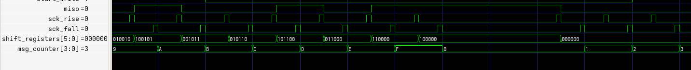

# SPI Controller Design

## Design goals
Because the SPI controller deals with external signals (from any device which wishes to use our hash accelerator), reducing risk of metastability is the primary concern. Because the MOSI and MISO frames overlap (see [spec.md](./spec.md)), the SPI controller is also responsible for ensuring all bits are at their correct positions within the frame.

## Design
To reduce risk of metastability, a synchronization chain is used, where each external input (`SCK` and `MOSI`) is clocked into a capture register, then from that register into a second synchronization register. Because `SCK` is synchronized, a third register is added to track the previous synchronized value of `SCK` for edge detection (where we detect edges by comparing the current and previous synchronized values of `SCK`). Rising and falling `SCK` edges are exposed to the SPONGENT core as pulses, as well as the synchronized `MOSI`.

The SPONGENT core provides the output for `MISO`. However, because outputs from the SPONGENT core are determined combinationally on the earliest clock cycle possible (as described in the [design doc](./spongent_core_design.md)), the output byte must be held using shift registers so that it fills the least significant byte of the MISO frame. The SPONGENT core asserts a `write_enable` signal to the SPI controller when it has bits to output; this happens on the third most significant bit of the message frame (the most significant 2 bits are the command bits; the earliest clock cycle the SPONGENT core can begin its output is the third clock cycle, after it has received the command bits), which would place the output byte at bits `[13:6]`. The desired position is bits `[7:0]`; as such, the output from the SPONGENT core is shifted through a 6-bit shift register, the last bit of which is output as `MISO`.

Note that because the final (least significant) bit of the output byte is output on the final bit of the message frame, this bit will remain in the final position of the shift register until the beginning of the next message, when it will be shifted out on the rising `SCK` edge (as per SPI mode 1 \[1\]). This is okay; because SPI mode 1 specifies `CPOL = 0`, i.e. `SCK` idles low \[1\], the next message must begin with a rising edge before sampling on the falling edge \[1\].

# References
\[1\] "Serial Peripheral Interface." Wikipedia. Accessed: Nov. 26, 2026. [Online]. Available: https://en.wikipedia.org/wiki/Serial_Peripheral_Interface.
