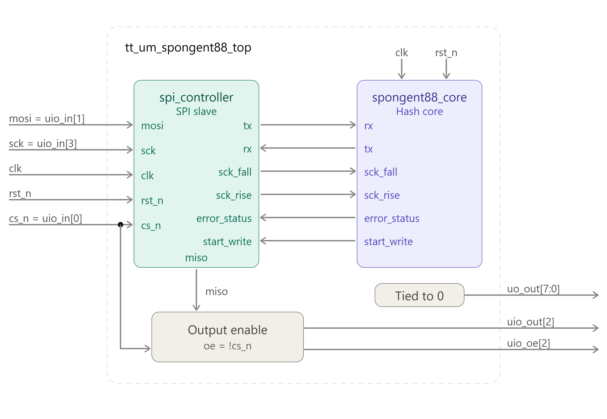
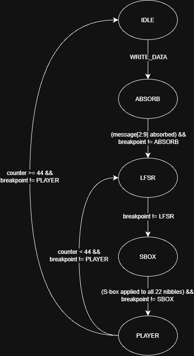

# SPONGENT-88 Core Architecture

## Design goals
The primary goal of our design was to simply fit the implementation onto one tile. We weren't sure if we could accomplish this; a [prior Tiny Tapeout submission of the same algorithm](https://github.com/imix/ttihp-spongent88) used four tiles. We accomplished this by serializing much of the implementation and minimizing the number of registers used.

We wanted our device to be interfaced via a standard communication protocol. SPI was chosen for its simplicity - see [spec.md](./spec.md) for details about the interface.

Refer to \[2\] for details about the SPONGENT algorithm

## System diagram

## Design

The SPONGENT-88 core module is implemented as a finite state machine (FSM) with 5 states:
- `IDLE`
- `ABSORB`
- `LFSR`
- `SBOX`
- `PLAYER`

There is a 6-bit counter that is reused throughout the design.

To handle messages in parallel with the FSM, there is a 2-bit command register and a 4-bit counter, which counts the number of message bits received. There is an 8-bit shift register for the output, and an 8-bit control register.

## Handling messages

Once the first 2 message bits (the command bits) have been received, the command is handled accordingly:
- `WRITE_DATA` (`00`)
    - If the current state is `IDLE`, transition to the `ABSORB` state
    - Otherwise, output an error (see [spec.md](./spec.md) for status format)
- `WRITE_CONTROL` (`01`)
    - For the next 8 SPI clocks, shift the incoming message bit into the control register
- `READ_DATA` (`10`)
    - If the FSM state matches the breakpoint (see Debugging section below), check the control register to determine which byte to output (see Debugging section below)
        - Valid range: `[0, 10]`
        - If byte 0 is selected, the FSM transitions to `LFSR` to begin another application of the `PI_b` permutation, as is specified for the squeezing phase in \[2\]
        - If an invalid byte is selected, byte 0 is output, but the FSM does not transition to `LFSR` to begin another permutation - this can be used for debugging purposes
- `READ_STATUS` (`11`)
    - The current status is determined combinationally, and the corresponding bits are placed into the output shift register

Note that all commands other than `READ_DATA` output the status, which is determined combinationally each time. Note also that the output is loaded into the shift register on the earliest possible clock cycle; i.e., on the clock cycle immediately after the 2 command bits have been received.

By counting the number of received bits and handling message bits individually based on their index (see below FSM state descriptions for more details), we avoid needing a shift register for the entire message; we only need to store the 2-bit command, which determines how the rest of the message is handled.

## FSM design
- `IDLE`
    - This is the idle state - transitions from this state are determined by the 2 command bits of the message (see above)
- `ABSORB`
    - Bits \[2:9\] of the message are absorbed directly into the SPONGENT-88 state
        - This eliminates the need for a shift register to hold the hash input chunk
    - The 6-bit counter is used to count these bits and to determine the correct index to XOR the incoming bit into
    - After all bits have been absorbed, the counter is reset to 0 and the LFSR is reset to its initial value, described in \[2\]
    - The FSM then transitions to the `LFSR` state
- `LFSR`
    - Note that this is the first step of the `PI_b` permutation
    - The LFSR register is XOR'ed into the least significant 6 bits of the SPONGENT-88 state, and the reversed LFSR register is XOR'ed into the most signficant 6 bits
    - The LFSR register is incremented - see \[2\] for the polynomial used
    - The FSM then transitions to the `SBOX` state
- `SBOX`
    - The S-box layer is applied serially; the S-box (which just substitutes nibbles for other nibbles) is applied to one nibble at a time
    - A 5-bit counter, counting from 0-21, is used to track which nibble is being processed
    - When the counter reaches 21, it is reset, and the FSM transitions to `PLAYER`
- `PLAYER`
    - The P-layer simply moves bits around in the state based on their index (see \[2\] for the bit permutation)
    - The P-layer is applied to the entire SPONGENT-88 state in parallel, as it moves the bits of the SPONGENT-88 state around; this can be done combinationally if the entire state is processed in one clock cycle, otherwise bits may be overwritten and lost by the time we get to them
    - As described in \[2\], the LFSR, S-box, and P-layer must be applied 45 times - at this stage, one "round" of the `PI_b` permutation has been completed, so we check the 6-bit counter, which is now being used to count the rounds
        - Note that until all rounds have been completed, the 6-bit counter will not be used for any other purpose, since `ABSORB` will not be repeated during the permutation
        - If all rounds have been completed (`counter == 44` since the counter has not been incremented yet at this point), we reset the 6-bit counter and transition back to `IDLE`; the `PI_b` permutation has completed
        - Otherwise, we increment the counter and transition to the `LFSR` state (the first step of the `PI_b` permutation)

## Debugging
There is some debug functionality built into the design. Refer to [spec.md](./spec.md) for the register bitfields.

The `read_byte` field of the control register allows selection of one of the 11 bytes of the SPONGENT state to read using the `READ_DATA` command. The valid range is `[0, 10]`. If any byte other than byte 0 is selected, calling `READ_DATA` will NOT apply the `PI_b` permutation; if byte 0 is selected, the standard squeezing behaviour described in \[2\] applies (i.e. the `PI_b` permutation will begin). If desires to read byte 0 without triggering an application of the `PI_b` permutation, setting `read_byte` to a value greater than 10 will cause byte 0 to be output when calling `READ_DATA`, but `PI_b` will not be applied.

The `breakpoint` field of the control register defines a state to freeze the FSM at. Execution pauses right before the FSM would transition away from this state, and it remains paused until the breakpoint is changed. For example, if `breakpoint` is set to `SBOX`, the S-box will be applied to all 22 nibbles of the SPONGENT-88 state, and the 5-bit S-box counter will be reset; after this, instead of transitiong to `PLAYER`, execution pauses until `breakpoint != SBOX`.

# References
\[1\] S. Aeschbacher. "Spongent-88: Lightweight Post-Quantum Hash Accelerator." GitHub. Accessed: Nov. 25, 2026. \[Online\]. Available: https://github.com/imix/ttihp-spongent88.

\[2\] A. Bogdanov, M. Knezevic, G. Leander, D. Toz, K. Varici, I. Verbauwhede, "SPONGENT: A Lightweight Hash Function," in CHES 2011, 2011, pp. 312-325, doi: https://doi.org/10.1007/978-3-642-23951-9_21.
