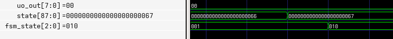

# Testing: ABSORB state

Tested using cocotb
(Refer to branch `absorb-test`)

Note that this was tested independently of the SPI module. SPONGENT-88 core pins were wired directly to top-level pins for testing purposes.

Tested:
- Read status when ready
- Absorb `0x67` into SPONGENT-88 state (see below)
- Read status when busy
- Write (i.e. attempt another absorb) when busy

All tests passed

\
`fsm_state` also behaves properly, with `001` representing ABSORB and `010` representing LFSR (the next state - yet to be implemented)
