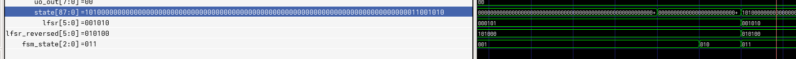
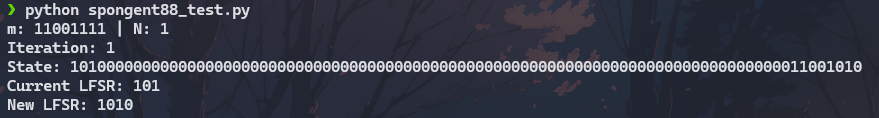

# Testing: LFSR state

Tested using cocotb. Resulting `tb.gtkw` file was analyzed using GTKWave and compared against [an existing Python implementation](https://github.com/joostrijneveld/readable-crypto).

Note that this was tested independently of the SPI module. SPONGENT-88 core pins were wired directly to top-level pins for testing purposes.

The Python implementation had to be slightly modified for the message to be absorbed properly. It is currently unknown if this is a quirk of SPONGENT, or if it is a bug in the Python implementation. Either way, this part of absorption is the responsibility of the caller.

The state, current LFSR, and new LFSR were compared and verified to be the same.

cocotb waveform:

Python implementation:

